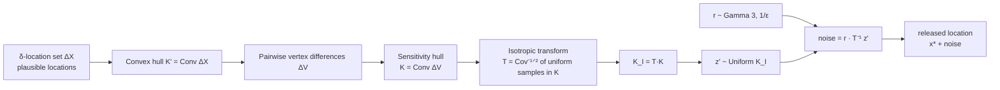
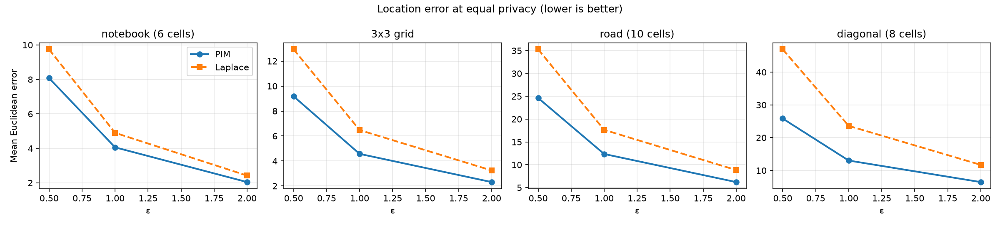
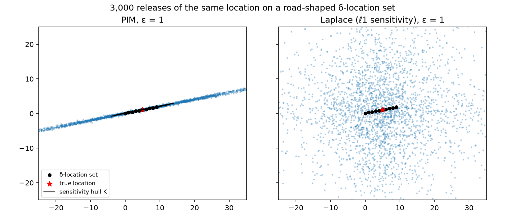

# Location Privacy: Planar Isotropic Mechanism

A Python implementation of the **Planar Isotropic Mechanism (PIM)** for differentially private location release, from Xiao & Xiong, *"Protecting Locations with Differential Privacy under Temporal Correlations"* (ACM CCS 2015). It's benchmarked against a correctly calibrated Laplace baseline over 20,000 Monte Carlo trials per setting.


## Problem

Location-based apps need your position, but sharing exact coordinates reveals your home, workplace and routine. Differential privacy can protect a released location, but standard Laplace noise calibrated to ℓ1 sensitivity **over-perturbs**. It adds the same amount of noise in every direction even when the plausible locations (the *δ-location set*) only vary along one direction, such as a road. PIM shapes the noise to the geometry of the plausible locations, giving the same privacy guarantee with less error.

## How PIM works (Algorithm 2 of the paper)



- **Sensitivity hull** (`sensitivity_hull`): K is centrally symmetric (Theorem 4.1), and every pair of plausible locations satisfies ‖x₁ − x₂‖_K ≤ 1. This is exactly what makes the release **ε-differentially private on the δ-location set**.
- **K-norm noise** (`PlanarIsotropicMechanism.noise`): a Gamma(3, 1/ε) radius times a uniform point in the hull gives density ∝ exp(−ε‖z‖_K), which is the K-norm mechanism.
- **Isotropic position** (`isotropic_transform`): T whitens K (Eq. 6, resampled until stable). With an exact uniform sampler, the transform leaves the output distribution unchanged, since T⁻¹ maps uniform-on-TK back to uniform-on-K. It's implemented to follow the paper, where it underpins the optimality analysis and approximate samplers.
- **Laplace baseline** (`LaplaceMechanism`): independent Laplace noise per coordinate with scale = (ℓ1 diameter of ΔX) / ε, the baseline the paper compares against.

## Tech stack

| Area | Tools |
|---|---|
| Core | Python 3.11, NumPy, SciPy (`ConvexHull`, statistical tests) |
| Evaluation | Monte Carlo simulation, Matplotlib |
| Quality | pytest (26 tests, including statistical distribution tests), ruff, GitHub Actions |

## My role

Team project (5 members) for *ITIS 6220: Data Privacy* at UNC Charlotte (Spring 2025). I wrote the team's code for the course. This repository is a later, corrected re-implementation of the mechanism. The course notebooks used simplified noise that didn't follow the paper's sampling procedure and didn't calibrate Laplace noise to sensitivity, so the mechanism was rebuilt to match Algorithm 2 exactly, with tests and a Monte Carlo evaluation.

## How to run

```bash
pip install -r requirements.txt
PYTHONPATH=. python experiments/evaluate.py      # ~10 s; writes results/*.csv and *.png
```

```python
import numpy as np
from pim import PlanarIsotropicMechanism

delta_x = np.array([[1, 1], [2, 2], [3, 1], [2, 3], [1, 2], [2, 1]])  # plausible locations
pim = PlanarIsotropicMechanism(delta_x, epsilon=1.0, rng=np.random.default_rng(0))
print(pim.release([2, 2]))  # ε-DP release of the true location (2, 2)
```

## Results

Mean Euclidean error over **20,000 releases** per setting (lower is better). Both mechanisms give the same ε-DP guarantee on the δ-location set ([`results/results.csv`](results/results.csv)).

| δ-location set | ε = 0.5 (PIM / Laplace) | ε = 1 | ε = 2 | PIM error vs. Laplace |
|---|---|---|---|---|
| Course notebook (6 cells) | 8.08 / 9.75 | 4.06 / 4.90 | 2.04 / 2.42 | **−17%** |
| 3×3 grid (paper §4 example) | 9.18 / 12.94 | 4.57 / 6.48 | 2.31 / 3.24 | **−29%** |
| Road (10 cells) | 24.63 / 35.28 | 12.36 / 17.64 | 6.21 / 8.84 | **−30%** |
| Diagonal corridor (8 cells) | 25.85 / 46.96 | 13.03 / 23.61 | 6.46 / 11.71 | **−45%** |

- PIM wins in every setting, and its advantage grows as the plausible locations get more **elongated or rotated**. That's where ℓ1 sensitivity over-perturbs most, matching the paper's motivation.
- The ratio is constant across ε because both mechanisms' noise scales as 1/ε.
- **Scope of the guarantee:** PIM hides the true location *among the δ-location set*, which is the paper's privacy definition. It adds little noise in directions where the plausible locations don't differ, as the plot below shows.

## Screenshots





## Testing

```bash
pip install -r requirements.txt pytest
pytest -q
```

The 26 tests check the paper's properties rather than just running the code:

- The sensitivity hull is centrally symmetric, matches the paper's 3×3-grid example (a 4×4 square of area 16), and bounds every pairwise difference by ‖x₁ − x₂‖_K ≤ 1.
- The uniform sampler stays inside the hull, and ‖u‖_K has CDF t², as it must for uniform points in a 2-D convex body (Kolmogorov–Smirnov test).
- The isotropic transform gives identity covariance.
- PIM noise norms follow **Gamma(2, 1/ε)**, the exact K-norm distribution, for 3 sets × 3 ε values (KS tests). The privacy ratio p(z|x₁)/p(z|x₂) ≤ e^ε holds, and releases are unbiased.
- Laplace uses the ℓ1 sensitivity (verified scale and distribution), and PIM beats it on elongated sets.

## Scope

This repo implements the per-timestamp release (Algorithm 2) for a given δ-location set. The paper's full framework (Algorithm 1) also builds that set from a Markov mobility model and updates it over time; that part isn't implemented here.

## Repo structure

```
.
├── pim/mechanisms.py          # sensitivity hull, sampler, isotropic transform, PIM, Laplace
├── experiments/evaluate.py    # Monte Carlo comparison + plots
├── results/                   # results.csv, error_vs_epsilon.png, noise_clouds.png
├── tests/test_mechanisms.py   # 26 property and statistical tests
└── requirements.txt
```

## Reference

Y. Xiao and L. Xiong. *Protecting Locations with Differential Privacy under Temporal Correlations.* ACM CCS 2015. [doi:10.1145/2810103.2813640](https://doi.org/10.1145/2810103.2813640)
